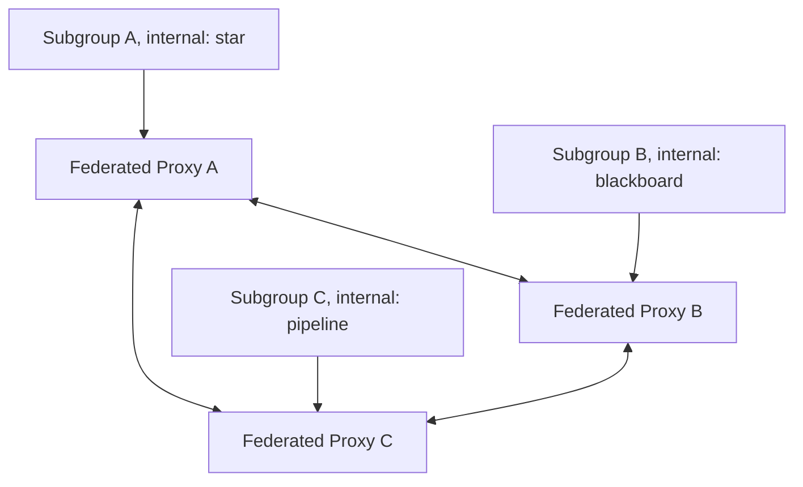

# Federated Clustering Architecture


English is the main document. A Chinese translation is available in
[`readme_CN.md`](./readme_CN.md).

## Project Introduction

Multi-agent systems usually scale up by adding more agents to one flat group,
which quickly turns into a scheduling and governance mess. This project
implements the **federated subgrouping** pattern instead: a large group nests
smaller groups, each subgroup runs autonomously with its own internal
collaboration style, and all cross-group traffic goes through a proxy gateway.

A mid-office contract-review workflow drives the whole link end to end — finance
initiates, legal reviews, finance archives — so the architecture is demonstrated
on a real-ish business flow rather than toy hello-world nodes.

Agents are simulated with local rules (no LLM API call), so the project runs out
of the box.

### What it demonstrates

- **Top-level federation bus**: a request-queue loop dispatches to proxies;
  proxies report back to the bus, forming a peer-to-peer collaboration cycle.
- **Three subgroup collaboration styles**: pipeline (finance / ops), blackboard
  (legal), and star dispatch (R&D).
- **Multi-level nesting**: the R&D subgroup nests frontend and backend
  sub-subgroups, each itself a compiled subgraph.
- **Proxy as the only outward face**: request validation, format conversion,
  subgraph invocation, result summarizing, and degraded fallback when the
  subgroup crashes.
- **Capability directory**: a global registry of what each subgroup can do, used
  for request validation and discovery.
- **Trace ID propagation**: one trace ID chains a multi-hop cross-group request
  (finance -> legal -> finance).

### Architecture



### How it maps to the seven common multi-agent architectures

| Architecture | Execution style | Key trait |
|---|---|---|
| Linear pipeline | Serial, fixed, one-way | Standardized SOP, easy to debug, fits sequential steps |
| Round-table negotiation | Round-robin, peer speaking | Multi-view debate, ordered turns, a moderator keeps order |
| Star dispatch | Central manager assigns on demand | Flexible routing, workers do not talk to each other |
| Hierarchical tree | Pyramid, decompose upward | Domain split, scales to large clusters, info aggregates layer by layer |
| Blackboard sharing | Read/write shared space, state-triggered | Experts are decoupled, contribute autonomously, good for evidence fusion |
| Mesh decentralization | Peer-to-peer direct, consensus | No center, no single point of failure, robust but harder to govern |
| Federated subgrouping | Subgroup autonomy + proxy cross-group, supports nesting | Groups iterate independently, scales to very large clusters, cross-domain has boundaries |

## Dependencies

- Python 3.11+
- `langgraph` (tested with 1.2.24). `langchain` is not required.

```powershell
pip install langgraph
```

## Project Structure

```
联邦分群架构/
├── federated_clustering.py      # main program: builds the graphs, runs 4 demo scenarios
├── test_federated_clustering.py # 13 test cases, run directly with python
├── readme.md                    # English documentation (main)
└── readme_CN.md                 # Chinese documentation
```

## Usage

### Run the demo

The console prints full-width separator lines (`——`). On a Windows console that
defaults to GBK these render as garbled characters, so enable UTF-8 output
first:

```powershell
$env:PYTHONIOENCODING="utf-8"
python federated_clustering.py
```

### Run the tests

```powershell
$env:PYTHONIOENCODING="utf-8"
python test_federated_clustering.py
```

All 13 cases pass.

### Demo scenarios

The main program runs four scenarios in sequence:

1. **Large-contract review** — a cross-group roundtrip: finance initiates, the
   amount (120,000) exceeds the threshold (50,000) so a cross-group request is
   sent to legal, legal returns a review conclusion, and finance archives it.
   One trace ID chains all three hops.
2. **R&D scheduling** — star dispatch from a lead; the chosen subgroup
   (frontend or backend) is itself a nested subgraph that produces its own
   estimate.
3. **Ops inspection** — a standalone pipeline subgroup, no cross-group traffic.
4. **Proxy circuit-breaker fallback** — a subgroup node is made to crash on
   purpose; the proxy catches the exception and returns a degraded result
   instead of breaking the whole link.

## Key Design Decisions

Real engineering notes from getting the graphs to run correctly on LangGraph 1.x:

- **State field loss with bare `dict`**. `StateGraph(dict)` silently drops any
  field a node does not return. The state is declared as a `TypedDict`
  (`GroupState`, `total=False`) listing every possible field, so fields a node
  does not mention are preserved across nodes.
- **Duplicated logs in nested subgraphs**. A nested subgraph returns logs that
  already include the outer logs passed in, so concatenating them naively
  doubles the prefix lines. Each nested call is invoked with an empty `logs`
  list, then the two lists are concatenated. A regression test
  (`test_rd_logs_no_dup`) guards this.
- **Proxy never peeks inside the subgroup**. The proxy only validates the
  request, translates the top-level request into the subgroup's input shape,
  invokes the compiled subgraph, and summarizes. The internal flow is entirely
  the subgroup's own business.

## Testing

`test_federated_clustering.py` covers: capability directory lookup, request /
trace-ID construction, all three subgroup styles, proxy validation and fallback,
the end-to-end finance -> legal -> finance chain, result-pool aggregation by
trace ID, and a regression test for log non-duplication.

## Contributing

- Fork the repository and create a feature branch off the latest main.
- Keep the code style consistent: semicolons, Chinese comments ending in `。`,
  `V_`-prefixed constants, and English identifiers / log output.
- Add or update tests in `test_federated_clustering.py` for any behavior change.
- Run the full test suite before opening a pull request; all 13 cases must pass.
- Commit messages should read like engineering notes — no "AI-generated" traces.

## Contact

谙弆悕博士（Ailan Anjuxi）

📫 邮箱：anjuxi.ME@outlook.com
📞 SIP 电话：sip:anjuxi@sip.linphone.org

> © 2026 谙弆悕博士（Ailan Anjuxi），All rights reserved.
