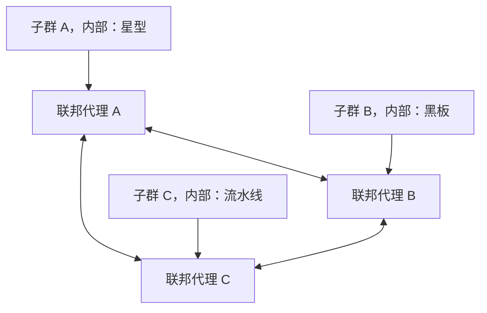

# 联邦分群架构


中文版文档，英文主文档见 [`readme.md`](./README.md)。

## 项目介绍

多智能体系统常见的做法是把越来越多的智能体塞进同一个扁平大群里，调度和治理很快就会乱成一锅粥。这个项目换了个思路，落地**联邦分群**模式：大群套小群，每个子群内部自治、有自己的协作风格，跨群通信统一走代理网关中转。

整条链路用一个中台合同审核流程跑通——财务发起、法务评审、财务归档——让架构在接近真实的业务流上演示，而不是停留在 hello-world 节点上。

智能体用本地规则模拟（不调用大模型 API），开箱即跑。

### 演示内容

- **顶层联邦总线**：请求队列循环派单给代理，代理处理完回总线，形成对等协作的闭环。
- **三种子群协作风格**：流水线（财务 / 运维）、黑板（法务）、星型派单（研发）。
- **多级嵌套**：研发子群内部再套前端、后端两个子子群，各自也是编译好的子图。
- **代理是唯一对外出口**：入参校验、格式转换、调子图、汇总结果，子群崩了还能降级兜底。
- **能力目录**：全局登记每个子群能做什么，用于请求校验和能力发现。
- **追踪 ID 透传**：一个追踪 ID 串起多跳跨群请求（财务 -> 法务 -> 财务）。

### 架构图



### 与七种常见多智能体架构的对照

| 架构 | 执行方式 | 关键特点 |
|---|---|---|
| 线性流水线 | 串行、固定、单向 | SOP 标准化、好调试，适合顺序步骤 |
| 圆桌协商 | 轮询、对等发言 | 多视角辩论、有序发言，靠主持控场 |
| 星型派单 | 中心主管按需分配 | 路由灵活，工人之间不直接对话 |
| 层级树 | 金字塔、向上汇总 | 按领域拆分，能扩到大集群，信息逐层聚合 |
| 黑板共享 | 读写共享空间、状态触发 | 专家解耦、自主贡献，适合证据融合 |
| 网状去中心化 | 对等直连、共识 | 无中心、无单点故障，健壮但难治理 |
| 联邦分群 | 子群自治 + 代理跨群，支持嵌套 | 各群独立迭代，能扩到超大集群，跨域有边界 |

## 依赖说明

- Python 3.11+
- `langgraph`（实测版本 1.2.24），不需要 `langchain`。

```powershell
pip install langgraph
```

## 项目结构

```
联邦分群架构/
├── federated_clustering.py      # 主程序：建图并跑 4 个演示场景
├── test_federated_clustering.py # 13 个测试用例，直接 python 运行
├── readme.md                    # 英文文档（主文档）
└── readme_CN.md                 # 中文文档
```

## 使用说明

### 运行演示

控制台会打印全角分隔线（`——`）。Windows 控制台默认 GBK 编码下会显示成乱码，先开 UTF-8 输出：

```powershell
$env:PYTHONIOENCODING="utf-8"
python federated_clustering.py
```

### 运行测试

```powershell
$env:PYTHONIOENCODING="utf-8"
python test_federated_clustering.py
```

13 个用例全部通过。

### 演示场景

主程序依次跑四个场景：

1. **大额合同审核**——跨群往返：财务发起，金额（120,000）超过阈值（50,000），向法务发跨群请求，法务返回评审结论，财务归档。一个追踪 ID 串起三跳。
2. **研发排期**——主管星型派单；被选中的子群（前端或后端）本身是嵌套子图，自己产出排期。
3. **运维巡检**——独立的流水线子群，不跨群。
4. **代理熔断兜底**——故意让子群节点崩溃，代理接住异常返回降级结果，整条链路不崩。

## 关键设计说明

在 LangGraph 1.x 上把图跑通的过程中记的几条工程笔记：

- **裸 `dict` 会丢状态字段**。`StateGraph(dict)` 会悄悄裁掉节点没返回的字段。状态用 `TypedDict`（`GroupState`，`total=False`）把所有可能字段都声明出来，节点没提到的字段也能保留。
- **嵌套子图日志重复**。嵌套子图返回的日志已经包含传进去的外层日志，直接拼接会把前缀行重复一遍。每次嵌套调用传空的 `logs` 进去，跑完再把两份拼起来。有个回归用例（`test_rd_logs_no_dup`）盯着这件事。
- **代理不窥探子群内部**。代理只校验请求、把顶层请求转成子群认得的入参、调用编译好的子图、汇总结果。子群内部怎么跑完全是它自己的事。

## 测试

`test_federated_clustering.py` 覆盖：能力目录查询、请求 / 追踪 ID 构造、三种子群风格、代理校验与兜底、财务 -> 法务 -> 财务端到端链路、按追踪 ID 归集结果池，以及日志不重复的回归测试。

## 贡献指南

- Fork 仓库，从最新主分支拉一个功能分支。
- 保持代码风格一致：分号、中文注释以 `。` 结尾、`V_` 前缀常量、英文标识符与日志输出。
- 任何行为改动都要在 `test_federated_clustering.py` 里新增或更新测试。
- 提 PR 前跑完整测试套件，13 个用例必须全过。
- 提交信息写得像工程笔记，不要留「AI 生成」之类的痕迹。

## 联系作者

谙弆悕博士（Ailan Anjuxi）

📫 邮箱：anjuxi.ME@outlook.com

📞 SIP 电话：sip:anjuxi@sip.linphone.org

> © 2026 谙弆悕博士（Ailan Anjuxi），All rights reserved.
